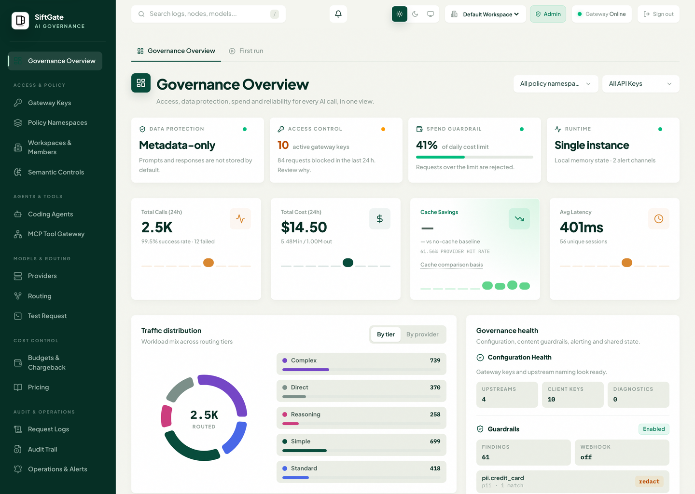
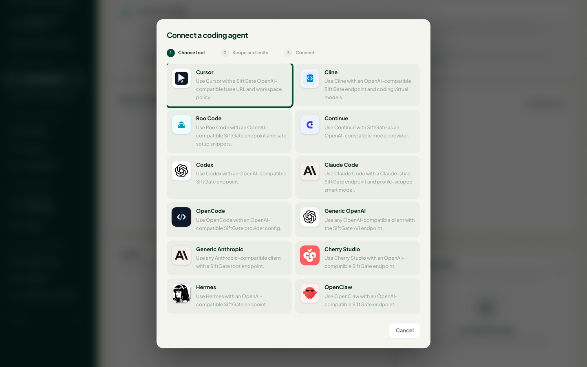
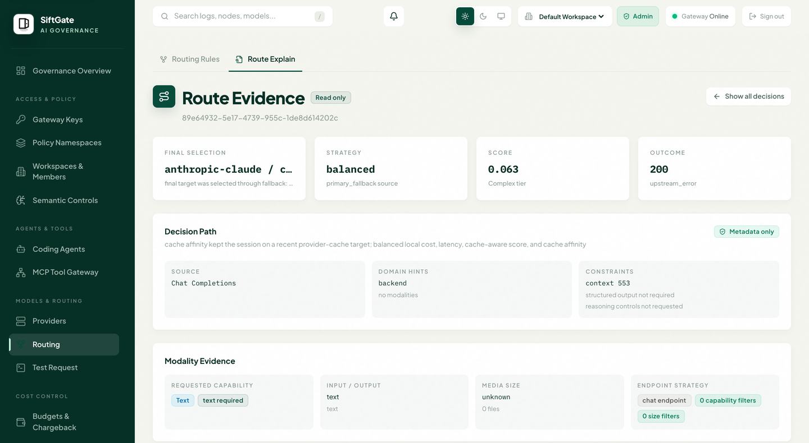
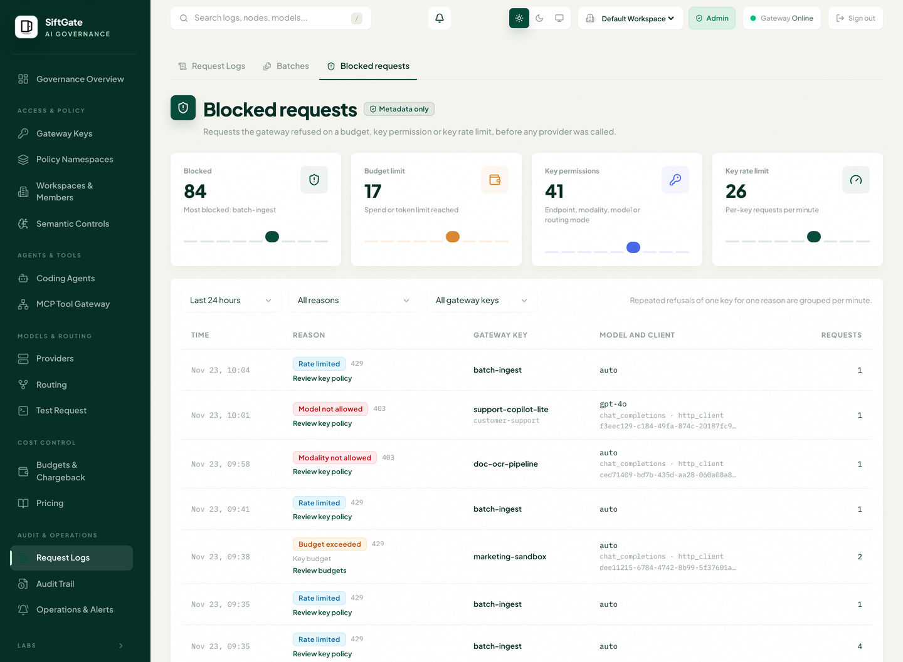
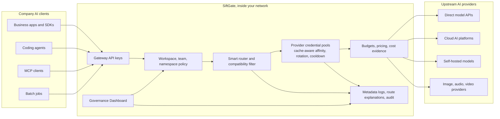

<p align="center">
  
</p>

<h1 align="center">Self-Hosted AI Gateway for Enterprise AI Governance</h1>

<p align="center">
  One control point for every AI call your company makes. Provider keys stay on
  your servers, access follows policy, spend is budgeted and charged back, and
  every request leaves an audit trail without storing prompts or responses.
</p>

<p align="center">
  <a href="https://github.com/seanbabalala/SiftGate/releases/tag/v2.14.0"></a>
  <a href="LICENSE"></a>
  <a href="docs/security-compliance-brief.md"></a>
  <a href="docs/README.md"></a>
</p>

<p align="center">
  Current release: <strong>v2.14.0</strong> (availability: signed release assets and successful release workflow)
</p>
<!-- Current release: **v2.14.0** — verify signed release assets and the release workflow before installing -->

<p align="center">
  <a href="docs/QUICKSTART.md"><strong>Quickstart</strong></a>
  · <a href="docs/enterprise-overview.md"><strong>Enterprise overview</strong></a>
  · <a href="docs/security-compliance-brief.md"><strong>Security brief</strong></a>
  · <a href="docs/poc-playbook.md"><strong>30-minute PoC</strong></a>
  · <a href="docs/PRODUCTION.md"><strong>Production</strong></a>
  · <a href="#enterprise-support"><strong>Enterprise support</strong></a>
</p>

<p align="center">
  <a href="docs/i18n/en/README.md">English</a>
  · <a href="docs/i18n/zh/README.md">简体中文</a>
  · <a href="docs/i18n/zh-TW/README.md">繁體中文</a>
  · <a href="docs/i18n/ja/README.md">日本語</a>
  · <a href="docs/i18n/ko/README.md">한국어</a>
  · <a href="docs/i18n/th/README.md">ไทย</a>
  · <a href="docs/i18n/es/README.md">Español</a>
</p>

<p align="center">
  
</p>

<table>
  <tr>
    <td align="center" width="20%"><strong>0</strong><br><sub>prompts or responses stored by default</sub></td>
    <td align="center" width="20%"><strong>4</strong><br><sub>policy scopes: workspace, team, namespace, key</sub></td>
    <td align="center" width="20%"><strong>50+</strong><br><sub>provider metadata profiles</sub></td>
    <td align="center" width="20%"><strong>7</strong><br><sub>Dashboard and docs languages</sub></td>
    <td align="center" width="20%"><strong>Signed</strong><br><sub>release assets with Sigstore provenance</sub></td>
  </tr>
</table>

SiftGate is an MIT-licensed AI gateway that you run on your own
infrastructure. Business apps, coding agents such as Claude Code, Codex and
Cursor, SDKs and MCP tools send requests to SiftGate instead of calling AI
providers directly. SiftGate decides who may call which model, which provider
key is used, what the request may cost, and what evidence is kept, before the
request leaves your network.

## Why Enterprises Put A Gateway In Front Of AI

AI adoption usually starts with a few provider keys. At company scale it turns
into a governance problem:

| What breaks as AI use grows | What SiftGate changes |
| --- | --- |
| **Shadow AI and key sprawl.** Engineers paste provider keys into editors, agents and MCP tools. Nobody can say who uses which model, and offboarding cannot revoke access. | Provider keys stay inside the gateway. Teams and people get scoped, revocable Gateway API keys limited to approved endpoints, modalities, nodes and models. |
| **Security review blocks rollout.** Security and legal teams worry that a new proxy becomes a store of prompts, source code and customer data. | Metadata-only by default: no prompts, responses, raw headers, source code, diffs, tool payloads, media bytes or resolved secrets are stored unless an operator explicitly enables it. |
| **Spend arrives as one unexplained bill.** Costs cannot be attributed to teams or projects, and rotating keys breaks provider prompt caches. | Budgets at global, namespace, team and key scope, workspace price books, chargeback exports, and cache-aware credential pools that keep cache locality across keys. |
| **One provider outage stops everyone.** Rate limits and incidents halt work, and nobody can explain why traffic moved. | Fallback chains, circuit breakers and per-key credential failover, with a route explanation for every request. |

## Four Governance Pillars

**1. Access and policy.** One ingress for OpenAI- and Anthropic-compatible
chat, embeddings, rerank, media, Batch and MCP tool traffic, routed to any
configured provider, including Gemini, Bedrock and Azure. Permissions are the
intersection of Gateway API key, Team and Policy Namespace rules, and an empty
intersection fails closed. Per-key model pools route an exact chat model across
approved nodes. The Dashboard has authentication on by default, fixed
admin/operator/viewer roles, Workspaces, invitations and optional OIDC.
Quick connect creates a scoped key and a bound coding agent profile in one step.
Every request refused by a key permission, a key's rate limit or a budget is
recorded as metadata under **Blocked requests**, by key, reason and minute.

**2. Data protection and audit.** Call logs, route traces, sessions, MCP calls,
batch jobs and guardrail findings record metadata, not content. The optional
local guardrails plugin redacts or blocks PII, secrets, prompt injection and
policy matches, and records findings as metadata. Management actions go to a
hash-chained audit log, and configuration changes are versioned with
validation-first rollback. Full Gateway API keys are shown once; provider
secrets never appear in Dashboard APIs, logs or exports. A read-only privacy
posture lists every setting that would keep prompt or response content and
whether the running configuration has turned it on.

**3. Cost control.** Daily token and cost budgets at global, namespace, team
and key scope reject over-budget requests with `budget_exceeded`. Workspace
price books, admission previews, a cost report, chargeback CSV/JSON exports,
anomaly evidence and cache-savings reporting show where money goes. Cache-aware
credential pools reduce duplicated prompt-cache warmup across parallel keys.

**4. Reliability and operations.** Smart routing with compatibility filters,
fallback chains, circuit breakers and credential cooldowns. Route Explanation
shows which candidates were selected, skipped or rejected and why. Start on
SQLite, then move to PostgreSQL, optional Redis, Docker, Kubernetes or Helm,
OIDC, log sinks and OpenTelemetry. Customer release kits are signed with
Sigstore provenance, and the optional host Operator applies upgrades only from
reviewed, approved plans.

Read the [enterprise overview](docs/enterprise-overview.md) for the full
governance model, or hand the [security and compliance brief](docs/security-compliance-brief.md)
to your security reviewers.

The Dashboard follows the same structure. Its sidebar groups work into
**Access & Policy**, **Agents & Tools**, **Models & Routing**, **Cost Control**
and **Audit & Operations**, with previews and evaluation tools in a collapsed
**Labs** group. Related pages appear as tabs inside each section, and every
existing URL still works. The Governance Overview opens with the posture a
reviewer asks about first: whether any setting keeps content, how many
requests policy refused in the last 24 hours, spend against the daily limit,
and runtime health. See the [Dashboard guide](docs/DASHBOARD.md#navigation).

<p align="center">
  
</p>

## See It In A 30-Minute Evaluation

Each scenario below is part of the [PoC playbook](docs/poc-playbook.md), which
scripts the full demo with pass criteria.

**Govern a coding agent with a scoped key.** In **Coding Agents → Quick
connect**, pick the tool, then gateway routing or one model, and optionally a
policy scope, daily cost and per-minute limit. SiftGate creates the scoped
Gateway API key and a bound Agent Profile together and renders the setup
snippet. The engineer's machine never holds a provider key, and `coding-auto`
maps to policy-respecting smart routing.

```env
ANTHROPIC_BASE_URL=http://localhost:2099
ANTHROPIC_AUTH_TOKEN=<SIFTGATE_GATEWAY_API_KEY>
ANTHROPIC_MODEL=coding-auto
```

<p align="center">
  
</p>

**Pool provider keys without losing prompt cache.** Several upstream keys live
inside one logical node. `cache_aware` keeps a session on the key that already
holds its provider prompt cache and moves to another key on 429, 5xx or
timeouts.

```yaml
nodes:
  - id: enterprise-anthropic
    name: "Enterprise Anthropic"
    protocol: messages
    base_url: "https://api.anthropic.com"
    endpoint: "/v1/messages"
    auth_type: x-api-key
    credentials:
      - id: primary
        api_key: "${env:ANTHROPIC_POOL_KEY_PRIMARY}"
      - id: backup
        api_key: "${env:ANTHROPIC_POOL_KEY_BACKUP}"
    credential_pool:
      enabled: true
      strategy: cache_aware
      sticky_by: agent_session
      cooldown_ms: 60000
      retry_on_status: [429, 500, 502, 503, 504]
```

Credential ids appear in logs; secret values never do.

**Explain any request without storing it.** Every response carries an
`x-siftgate-request-id` header. Open `/route-decisions/<request-id>` in the
Dashboard to see the selected and rejected candidates, policy filters,
credential hit, cache effect, fallback reason, latency and cost estimate. The
prompt and response were never written to disk.

<p align="center">
  
</p>

**Show what the gateway refused, and why.** Point a key with a narrow scope at
a model, endpoint or budget it does not cover. Each refusal is recorded as
metadata in **Request Logs → Blocked requests**, grouped per key, reason and
minute, with filters for both. Refusals stay out of call logs, so success
rates, routing samples and cost reports are unchanged.

<p align="center">
  
</p>

## What Each Team Gets

| Role | What SiftGate gives them |
| --- | --- |
| CTO and platform owner | One provider-neutral entry point for apps, agents and tools; switch or mix providers without client changes. |
| CISO and security review | Metadata-only defaults, a privacy posture of every content-keeping setting, provider-key isolation, fail-closed Dashboard auth, RBAC and OIDC, hash-chained audit, signed releases. |
| Finance and FinOps | Budgets at global, namespace, team and key scope, refused-request evidence per key, chargeback exports by team and project, cost and cache-savings evidence. |
| Engineering and SRE | OpenAI- and Anthropic-compatible endpoints, automatic failover, route explanations, alerts to Feishu, WeCom, Telegram or webhooks. |

## Architecture



By default SiftGate stores operational metadata: request id, selected node and
model, credential id and retry count, latency, status, token usage, cost
estimate, policy labels, fallback reason, cache evidence and route explanation.
It does **not** store prompts, responses, raw provider headers, provider keys,
tool payloads, media bytes, hidden reasoning text or resolved secrets unless a
feature is explicitly configured to retain content.

The open-source gateway is complete on its own. AI requests never need to pass
through a hosted service, and no control plane is required.

## From PoC To Production

| Stage | Recommended setup |
| --- | --- |
| PoC | [Customer install kit](docs/customer-install.md) with Docker, SQLite and a one-time activation code, or the source quick start below. |
| Pilot team | Docker Compose, Dashboard-managed Gateway API keys, Policy Namespaces, budgets, alert connectors, log retention. |
| Production | PostgreSQL, optional Redis shared state, OIDC, secret references, log sinks, OpenTelemetry, Kubernetes or Helm, validation-first config rollout. |
| Multi-instance | Load balancer, shared PostgreSQL, Redis-backed rate limits, circuit state and cache, health checks, controlled rollout. |

See [Production](docs/PRODUCTION.md), [Kubernetes and Helm](docs/KUBERNETES.md)
and [signed release verification](docs/customer-artifact-verification.md).

## Quick Start

For a versioned, persistent Docker installation, use the
[customer install kit](docs/customer-install.md) ([中文](docs/customer-install.zh-cn.md)).
Source availability does not mean the newest image is already published.

To run from source:

```bash
git clone https://github.com/seanbabalala/SiftGate.git
cd SiftGate
# Select Node >=22.13.0 <23 using .nvmrc (nvm install && nvm use when available).
npm run runtime:check
npm install
cd frontend && npm install && cd ..
cp gateway.config.example.yaml gateway.config.yaml
cp .env.example .env
npm run build
# Configure dashboard.password (or OIDC) in the private YAML before this step.
npm start
```

SiftGate loads `.env` automatically. Example provider nodes use secret
references such as `${env:OPENAI_API_KEY}`, so the Dashboard starts before
provider keys are filled in. A source installation needs `dashboard.password`
or OIDC configured first: a plaintext password is hashed on startup, and
missing credentials fail closed with no generated password in logs. The
customer kit uses a one-time activation code instead; follow the documentation
shipped with your kit version.

| Surface | URL |
| --- | --- |
| Dashboard | `http://localhost:2099/dashboard` |
| OpenAPI | `http://localhost:2099/docs` |
| Gateway | `http://localhost:2099` |

Add one upstream node, create a Gateway API key in the Dashboard, then send a
request:

```bash
curl http://localhost:2099/v1/chat/completions \
  -H "content-type: application/json" \
  -H "authorization: Bearer ${SIFTGATE_API_KEY}" \
  -d '{
    "model": "auto",
    "messages": [{"role": "user", "content": "Explain SiftGate in one sentence."}]
  }'
```

For a container-first path, use [Docker Quickstart](docs/DOCKER_QUICKSTART.md).

<details>
<summary><strong>Gateway API surface</strong></summary>

Existing clients move behind the gateway by changing the base URL and key.

| Endpoint | Purpose |
| --- | --- |
| `POST /v1/chat/completions` | OpenAI Chat Completions-compatible ingress |
| `POST /v1/responses` | OpenAI Responses-compatible ingress |
| `POST /v1/messages` | Anthropic Messages-compatible ingress |
| `POST /v1/embeddings` | Embedding routing |
| `POST /v1/rerank` | Rerank routing |
| `POST /v1/images/generations` | Image generation |
| `POST /v1/images/edits` | Image edits with JSON or multipart pass-through |
| `POST /v1/images/variations` | Image variations |
| `POST /v1/audio/transcriptions` | Audio transcription |
| `POST /v1/audio/translations` | Audio translation |
| `POST /v1/audio/speech` | Text-to-speech |
| `POST /v1/videos/generations` | Experimental async video generation preview |
| `POST /v1/batches` | OpenAI-compatible Batch API proxy |
| `WS /v1/realtime` | Experimental Realtime pass-through, disabled by default |
| `GET /v1/models` | OpenAI-compatible model list and gateway aliases |
| `POST /v1/feedback` | Metadata-only route feedback |

Interactive OpenAPI documentation is served at `GET /docs`.

</details>

<details>
<summary><strong>Provider and model ecosystem</strong></summary>

| Family | Examples |
| --- | --- |
| Direct model APIs | OpenAI, Anthropic, Google Gemini / Vertex, Mistral, DeepSeek, xAI, Cohere, AI21 Labs |
| China providers | Qwen / DashScope, Baidu Qianfan, Volcengine Ark / Doubao, Zhipu GLM, Moonshot / Kimi, MiniMax, Tencent Hunyuan, 01.AI |
| Aggregators | OpenRouter, Hugging Face Inference Providers, Replicate, Together AI, Fireworks AI, NVIDIA NIM, GitHub Models |
| Cloud platforms | AWS Bedrock, Azure OpenAI, Cloudflare Workers AI, IBM watsonx.ai, Databricks Mosaic AI |
| Media generation | fal.ai, Stability AI, Black Forest Labs, Ideogram, Luma AI, Runway, Pika |
| Speech, audio, embedding, rerank | ElevenLabs, Deepgram, AssemblyAI, Cartesia, Speechmatics, Voyage AI, Jina AI |
| Local and self-hosted | Ollama, vLLM, LM Studio, llama.cpp server, TGI, SGLang, Xinference, Baseten, Lepton AI, Modal, RunPod, Predibase, Lamini |
| Hosted compatible inference | DeepInfra, Nebius AI Studio, Novita AI, FriendliAI |

Catalog data is operational guidance, not a billing authority. Local node
pricing, `models_pricing` and `catalog.override.yaml` remain the
operator-controlled source of truth. Live provider evidence is tracked in the
[Provider Smoke Matrix](docs/PROVIDER_SMOKE_MATRIX.md).

</details>
## Where SiftGate Fits

SiftGate is built for governing AI traffic your company owns: provider keys,
agent access, MCP tools, policy, budgets, route evidence and metadata-only
audit in one self-hosted system.

| If your main job is | Consider |
| --- | --- |
| Governing company-owned AI traffic across apps, agents and tools | SiftGate |
| Public API resale, prepaid wallets or reseller billing | One API or New API |
| The lightest cost-first model router for one agent or app | Manifest |
| A developer-centric multi-provider proxy | LiteLLM Proxy |

SiftGate is not an API resale platform, billing wallet, hosted prompt store,
workflow engine, model marketplace or mandatory SaaS control plane, and it does
not turn third-party catalog prices into billing truth. It builds on ideas from
Manifest, One API, New API and LiteLLM, and we are grateful for their public
work. The full capability matrix, acknowledgements and committed benchmark
evidence are in [Comparison](docs/COMPARISON.md) and
[Performance](docs/PERFORMANCE.md).

## Documentation

| If you are | Start here |
| --- | --- |
| Deciding whether to adopt | [Enterprise overview](docs/enterprise-overview.md) ([中文](docs/enterprise-overview.zh-cn.md)), [Comparison](docs/COMPARISON.md) |
| Reviewing security and compliance | [Security and compliance brief](docs/security-compliance-brief.md) ([中文](docs/security-compliance-brief.zh-cn.md)), [Security](docs/SECURITY.md), [Publication security](docs/PUBLICATION_SECURITY.md) |
| Running an evaluation | [PoC playbook](docs/poc-playbook.md) ([中文](docs/poc-playbook.zh-cn.md)), [Quickstart](docs/QUICKSTART.md), [Dashboard](docs/DASHBOARD.md) |
| Operating the platform | [Production](docs/PRODUCTION.md), [Kubernetes and Helm](docs/KUBERNETES.md), [Customer install](docs/customer-install.md), [Operator observability](docs/OPERATOR_OBSERVABILITY.md) |
| Connecting agents and tools | [Coding Agent Gateway](docs/CODING_AGENT_GATEWAY.md), [MCP Tool Gateway](docs/MCP_GATEWAY.md), [Agent + MCP demo](docs/AGENT_MCP_DEMO.md) |
| Managing cost | [Cost and chargeback platform](docs/COST_CHARGEBACK_PLATFORM.md), [Billing loop](docs/BILLING_LOOP.md) |
| Building on SiftGate | [API reference](docs/API_REFERENCE.md), [Architecture](docs/ARCHITECTURE.md), [SDKs](docs/SDKS.md), [Plugins](docs/PLUGINS.md) |

The [documentation home](docs/README.md) lists every guide, and the
[engineering baseline](docs/BASELINE.md) records the verification scope of the
current release.

## Enterprise Support

SiftGate runs without any hosted service. If your team needs help with
deployment, provider onboarding, a security review or a guided PoC, contact the
maintainer on Telegram: [@seanbbuu](https://t.me/seanbbuu). Provider
credentials, policy, billing and compliance stay under your operational
control.

## Contributing

The public repository tracks source, examples, docs, tests and deployment
manifests only. Local runtime config, databases, catalog sync cache and
private notes are ignored. Before opening a PR, run:

```bash
npm run public:check
npm run docs:check
npm run build
cd frontend && npm test && npm run build
```

Release branches also run the broader matrix in the
[Release Checklist](docs/RELEASE_CHECKLIST.md). Maintainers publishing images
follow the [formal image release runbook](docs/customer-release.md)
([中文](docs/customer-release.zh-cn.md)) and its state gate.

| Resource | Link |
| --- | --- |
| Contributing | [CONTRIBUTING.md](CONTRIBUTING.md) |
| Security policy | [SECURITY.md](SECURITY.md) |
| Code of conduct | [CODE_OF_CONDUCT.md](CODE_OF_CONDUCT.md) |
| Changelog | [CHANGELOG.md](CHANGELOG.md) |
| License | [MIT](LICENSE) |
