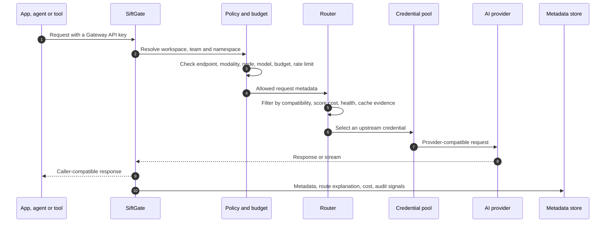

# SiftGate For Enterprise AI Governance

[中文](enterprise-overview.zh-cn.md) · [Security and compliance brief](security-compliance-brief.md) · [PoC playbook](poc-playbook.md)

This overview is for CTOs, platform owners and architects who need to explain
why the company should route AI traffic through a self-hosted gateway, what it
governs, and how to roll it out.

## The Problem

Most companies adopt AI bottom-up. A product team calls one provider, another
team calls a second, and engineers connect Claude Code, Codex, Cursor and MCP
tools with personal keys. Within months four questions have no answer:

1. **Who can use which model, and how do we revoke it?** Provider keys sit in
   laptops, CI secrets and editor configs. Offboarding cannot reliably remove
   access, and nobody can show which teams use which models.
2. **What happens to our data?** Security and legal teams need to know whether
   prompts, source code and customer data are being stored by yet another
   system, and they block rollout until someone can answer.
3. **Where does the money go?** The provider invoice arrives as one number.
   Finance cannot charge costs back to teams or projects, and nobody notices a
   runaway agent until the month ends.
4. **What happens when a provider fails?** A rate limit or outage at one
   provider stops everyone, and after the fact nobody can explain which
   requests moved where.

SiftGate answers these questions at the one place every request passes: a
gateway that you operate, between your AI clients and the providers.

## What SiftGate Governs

SiftGate governs three kinds of AI traffic with the same policy engine:

| Traffic | Examples | How it enters |
| --- | --- | --- |
| Business applications | Product features, internal tools, batch jobs, SDK clients | OpenAI- and Anthropic-compatible endpoints for chat, Responses, embeddings, rerank, images, audio and Batch |
| Coding agents | Claude Code, Codex, Cursor, Cline, Roo Code, Continue, OpenCode, generic OpenAI/Anthropic clients | Agent Profiles render a connector config that uses a scoped Gateway API key and virtual models such as `coding-auto` |
| MCP tools | HTTP JSON-RPC, Streamable HTTP, legacy SSE and stdio MCP servers | MCP Tool Gateway with key auth, namespace allow-lists and rate limits |

Clients change only their base URL and key. Provider keys never leave the
gateway.

## The Governance Model

Every request passes the same checks in order:

The checks map to four governance pillars.

### 1. Access And Policy

- **Scoped Gateway API keys.** Each team, application or person gets its own
  key. Keys can be limited to endpoints, modalities, nodes and models, can be
  rotated or disabled, and are shown in full only once.
- **Layered policy.** Workspaces isolate tenants or business units. Inside a
  workspace, Teams and Policy Namespaces carry shared rules. The effective
  permission is the intersection of key, team and namespace rules, and an empty
  intersection fails closed instead of becoming unrestricted.
- **Per-key model pools.** A key can pin an exact chat model to a round-robin
  or weighted pool of approved nodes, with fallbacks kept inside the pool.
- **Coding agents and MCP tools.** Agent Profiles render connector configs that
  contain a scoped key placeholder, never a provider key. The MCP Tool Gateway
  proxies approved MCP servers behind the same key auth and namespace
  allow-lists.
- **Dashboard identity.** Authentication is on by default and fails closed.
  Fixed admin, operator and viewer roles, workspace invitations and optional
  OIDC are included in the open-source gateway.

### 2. Data Protection And Audit

- **Metadata-only by default.** Call logs, route decision traces, sessions,
  MCP audit entries, batch and video job metadata, guardrail findings and eval
  reports store metadata, not content. Prompts, responses, raw headers,
  provider keys, tool payloads, media bytes, source code, diffs, hidden
  reasoning and resolved secrets are not stored unless a feature that retains
  content is explicitly enabled.
- **Local guardrails.** The official guardrails plugin runs inside the gateway
  and can audit, redact or block PII, secrets and tokens, prompt injection,
  jailbreak phrases, unsafe URLs and custom policy patterns. It records the
  rule, kind, action and match count, never the matched text.
- **Tamper-evident management audit.** Dashboard management events are
  redacted and hash-chained. Configuration changes are versioned and can be
  rolled back after validation.
- **Secrets stay out of the data path.** Provider keys can come from
  environment variables, HashiCorp Vault, AWS Secrets Manager or GCP Secret
  Manager references. Dashboard APIs, logs, route traces and exports never
  return secret values.

### 3. Cost Control

- **Budgets before spend.** Daily token and cost limits at global, Policy
  Namespace, Team and API key scope. Requests over budget are rejected with
  HTTP 429 and `error.type: budget_exceeded`.
- **Pricing you control.** Workspace price books with versioned rules,
  long-context, cache and time-window pricing, admission previews and a cost
  report. Third-party catalog prices are guidance, never billing truth.
- **Chargeback.** Cost by team, project, key, model and node, exported as CSV
  or JSON, with anomaly evidence for sudden spend changes.
- **Cache savings.** Cache-aware credential pools keep agent sessions on the
  key that holds their provider prompt cache, and the Dashboard reports the
  resulting provider-cache savings.

### 4. Reliability And Operations

- **Failover that explains itself.** Compatibility filtering, tiered routing,
  fallback chains, circuit breakers and credential cooldowns move traffic away
  from failing providers and keys. Route Explanation shows selected and
  rejected candidates and the reason for each decision.
- **A production path.** SQLite and in-memory state for evaluation;
  PostgreSQL, optional Redis shared state, Docker, Kubernetes, Helm, OIDC, log
  sinks and OpenTelemetry for production.
- **Controlled change.** Customer release kits carry Sigstore provenance that
  can be verified with GitHub CLI. The optional host Operator and Control Room
  apply upgrades and backups only from reviewed plans; Control Room requires a
  second person to approve.
- **Alerts.** Budget thresholds, cost anomalies, node and circuit changes,
  error and latency spikes, gateway availability and new releases can be sent
  to Feishu, WeCom, Telegram or generic webhooks.

## How SiftGate Compares

| Option | Strength | Gap for enterprise governance |
| --- | --- | --- |
| Direct provider keys | Fastest to start | No central revocation, attribution, budget or audit across providers |
| Provider-hosted consoles | Good per-provider usage views | One provider at a time; no shared policy for agents and MCP tools |
| Hosted AI gateways | Little to operate | Every prompt and response passes a third party's infrastructure |
| API resale panels (One API, New API) | Channels, quotas, recharge workflows | Built around redistribution and billing, not company-owned policy and evidence |
| Developer proxies (LiteLLM) | Broad provider compatibility | Governance, route evidence and agent controls are not the product center |
| **SiftGate** | Self-hosted policy, budgets, credential pools, agent and MCP governance, route evidence and metadata-only audit | You operate it; production use needs PostgreSQL and the usual service ownership |

See [Comparison](COMPARISON.md) for the full capability matrix.

## Rollout Plan

| Phase | Scope | Exit criteria |
| --- | --- | --- |
| Week 1: PoC | One workspace, one or two providers, one pilot team. Run the [PoC playbook](poc-playbook.md). | Scoped keys work from apps and one coding agent; budget and policy rejections are visible; security review receives the [brief](security-compliance-brief.md). |
| Month 1: engineering rollout | All coding agents and MCP tools move to Gateway API keys. Provider keys are removed from laptops and CI. Budgets per team. | No direct provider keys in developer tooling; chargeback export used in one monthly review. |
| Quarter 1: production traffic | Business applications move behind the gateway on PostgreSQL, optional Redis, OIDC and Kubernetes or Helm. Alerts and log sinks connected. | Failover tested, change process uses validated config rollback and reviewed upgrade plans. |

## Frequently Asked Questions

**Does SiftGate send our data anywhere?** AI requests go only to the providers
you configure. The only other outbound call is an optional release check
against the public GitHub releases API, which sends no keys, configuration or
usage and can be disabled with `SIFTGATE_RELEASE_UPDATES_DISABLED=1`. See
[release updates](release-updates.md).

**Do we need a SiftGate cloud account?** No. The open-source gateway is
complete on its own, and no hosted control plane is required.

**Can we keep using our existing SDKs and agents?** Yes. Clients change their
base URL and key; request and response formats stay OpenAI- or
Anthropic-compatible.

**What does it cost to run?** It is MIT-licensed. For evaluation it runs as one
process on SQLite. In production, plan for PostgreSQL, optional Redis and the
same operational ownership as any internal service.

**How much latency does it add?** Committed local benchmarks measure gateway
overhead against a mock upstream, and the engineering baseline records the
measured pricing-path overhead and its limits. Measure with your own traffic
profile before making capacity decisions; see [Performance](PERFORMANCE.md)
and the [engineering baseline](BASELINE.md).

**Who do we contact for help?** See [Enterprise support](../README.md#enterprise-support).
