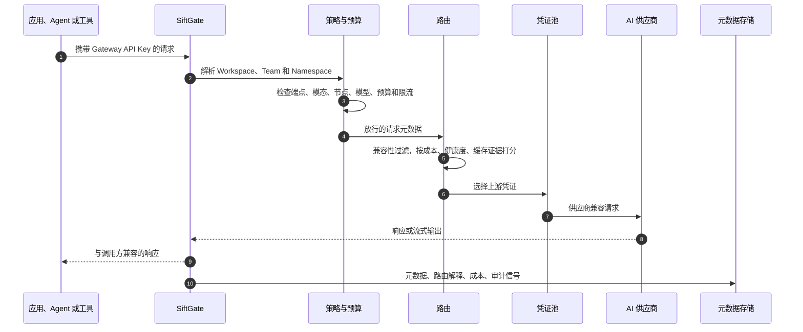

# SiftGate 企业 AI 治理方案

[English](enterprise-overview.md) · [安全与合规简报](security-compliance-brief.zh-cn.md) · [PoC 演示剧本](poc-playbook.zh-cn.md)

本文面向 CTO、平台负责人和架构师，用来说明：为什么企业要让 AI 调用经过一个自托管网关、它治理什么、以及如何分阶段落地。

## 企业面临的问题

多数企业的 AI 使用是自下而上长出来的。一个产品团队接了一家供应商，另一个团队接了第二家，工程师用个人 Key 接入 Claude Code、Codex、Cursor 和 MCP 工具。几个月后，下面四个问题都答不上来：

1. **谁能用哪个模型？怎么回收？** 供应商 Key 散落在笔记本、CI 密钥和编辑器配置里。员工离职无法可靠回收权限，也说不清哪些团队在用哪些模型。
2. **我们的数据去了哪里？** 安全和法务需要确认 Prompt、源码和客户数据会不会被又一个系统存下来，答不上来就不放行。
3. **钱花在了哪里？** 供应商账单只有一个总数。财务无法把成本分摊到团队或项目，失控的 Agent 要到月底才被发现。
4. **供应商出故障怎么办？** 一家供应商限流或故障，所有人一起停工；事后也没人能解释哪些请求被切到了哪里。

SiftGate 在每个请求都必经的位置回答这些问题：一个由你自己运维、位于 AI 客户端和供应商之间的网关。

## 治理范围

SiftGate 用同一套策略引擎治理三类 AI 流量：

| 流量类型 | 示例 | 接入方式 |
| --- | --- | --- |
| 业务应用 | 产品功能、内部工具、批处理任务、SDK 客户端 | OpenAI 与 Anthropic 兼容端点，覆盖 Chat、Responses、Embeddings、Rerank、图像、音频和 Batch |
| Coding Agent | Claude Code、Codex、Cursor、Cline、Roo Code、Continue、OpenCode，以及通用 OpenAI/Anthropic 客户端 | Agent Profile 生成连接配置，使用受限 Gateway API Key 和 `coding-auto` 等虚拟模型 |
| MCP 工具 | HTTP JSON-RPC、Streamable HTTP、旧版 SSE 和 stdio MCP 服务 | MCP Tool Gateway，统一 Key 鉴权、命名空间白名单和限流 |

客户端只需修改 Base URL 和 Key，供应商 Key 始终留在网关内。

## 治理模型

每个请求按固定顺序经过同一组检查：

这些检查对应四个治理支柱。

### 1. 接入与权限

- **受限 Gateway API Key。** 每个团队、应用或个人使用自己的 Key。Key 可以限定端点、模态、节点和模型，可轮换、可停用，完整值只展示一次。
- **分层策略。** Workspace 隔离租户或业务单元。Workspace 内由 Team 和 Policy Namespace 承载共享规则。实际权限取 Key、Team、Namespace 规则的交集；交集为空时直接拒绝，而不是变成不受限。
- **按 Key 的模型池。** 一个 Key 可以把某个精确的 Chat 模型固定到经批准节点组成的轮询或加权池中，fallback 也只在池内发生。
- **Coding Agent 与 MCP 工具。** Agent Profile 生成的配置只包含受限 Key 占位符，从不包含供应商 Key。MCP Tool Gateway 在同一套 Key 鉴权和命名空间白名单之后代理经批准的 MCP 服务。
- **控制台身份。** 默认开启认证且失败即关闭。开源版本内置 admin、operator、viewer 固定角色、Workspace 邀请和可选 OIDC。
### 2. 数据保护与审计

- **默认只存元数据。** 调用日志、路由决策记录、会话、MCP 审计、批处理与视频任务元数据、护栏发现和评测报告只记录元数据，不记录内容。除非显式开启会保留内容的功能，否则不存储 Prompt、响应、原始请求头、供应商 Key、工具载荷、媒体字节、源码、Diff、隐藏推理和解析后的密钥。
- **本地护栏。** 官方 guardrails 插件运行在网关内部，可以对 PII、密钥与令牌、Prompt 注入、越狱话术、不安全 URL 和自定义策略做审计、脱敏或拦截。它只记录规则、类型、动作和命中次数，从不记录命中的原文。
- **防篡改的管理审计。** 控制台管理操作以脱敏摘要写入哈希链审计日志。配置变更会生成版本，回滚前先校验目标版本。
- **密钥不进入数据路径。** 供应商 Key 可以来自环境变量、HashiCorp Vault、AWS Secrets Manager 或 GCP Secret Manager 引用。控制台 API、日志、路由记录和导出都不会返回密钥值。

### 3. 成本管控

- **花钱之前先拦截。** 在全局、Policy Namespace、Team、API Key 四级设置每日 Token 与费用上限。超出预算的请求返回 HTTP 429 和 `error.type: budget_exceeded`。
- **自己掌控的计价。** Workspace 级价格簿支持版本化规则、长上下文、缓存和时段计价，并提供准入试算和成本报表。第三方目录价格只作参考，从不作为计费依据。
- **成本分摊。** 按团队、项目、Key、模型和节点归集成本，导出 CSV 或 JSON，并对支出突变给出异常证据。
- **缓存节省。** 缓存感知凭证池让 Agent 会话留在持有其 Prompt 缓存的 Key 上，控制台展示由此带来的供应商缓存节省。

### 4. 可靠性与运维

- **可解释的故障切换。** 兼容性过滤、分层路由、fallback 链、熔断和凭证冷却会把流量从故障的供应商和 Key 上移走。路由解释（Route Explanation）展示被选中和被淘汰的候选，以及每个决策的原因。
- **完整的生产路径。** 评估阶段用 SQLite 和内存状态；生产阶段使用 PostgreSQL、可选 Redis 共享状态、Docker、Kubernetes、Helm、OIDC、日志出口和 OpenTelemetry。
- **受控变更。** 客户发行包附带 Sigstore 来源证明，可用 GitHub CLI 校验。可选的主机 Operator 和 Control Room 只按经过评审的计划执行升级和备份；Control Room 要求第二个人审批。
- **告警。** 预算阈值、成本异常、节点与熔断变化、错误与延迟突增、网关可用性和新版本发布，可以推送到飞书、企业微信、Telegram 或通用 Webhook。

## 方案对比

| 方案 | 优势 | 企业治理上的缺口 |
| --- | --- | --- |
| 直接使用供应商 Key | 上手最快 | 跨供应商无法统一回收、归因、预算和审计 |
| 供应商自带控制台 | 单一供应商的用量视图清晰 | 只能看一家；Agent 和 MCP 工具没有统一策略 |
| 托管型 AI 网关 | 几乎不用运维 | 所有 Prompt 和响应都要经过第三方基础设施 |
| API 分销面板（One API、New API） | 渠道、额度、充值流程 | 围绕分销和计费设计，而非企业自有流量的策略与证据 |
| 开发者代理（LiteLLM） | 供应商兼容面广 | 治理、路由证据和 Agent 管控不是产品重心 |
| **SiftGate** | 自托管的策略、预算、凭证池、Agent 与 MCP 治理、路由证据和只存元数据的审计 | 需要自己运维；生产使用需要 PostgreSQL 和常规的服务责任人 |

完整能力矩阵见 [Comparison](COMPARISON.md)。

## 落地计划

| 阶段 | 范围 | 完成标准 |
| --- | --- | --- |
| 第 1 周：PoC | 一个 Workspace、一到两家供应商、一个试点团队，按 [PoC 演示剧本](poc-playbook.zh-cn.md) 执行。 | 应用和一个 Coding Agent 能用受限 Key 调用；预算与策略拦截可见；安全评审拿到[简报](security-compliance-brief.zh-cn.md)。 |
| 第 1 个月：研发全面接入 | 所有 Coding Agent 和 MCP 工具改用 Gateway API Key，从笔记本和 CI 中移除供应商 Key，按团队设置预算。 | 研发工具中不再有直连供应商 Key；月度复盘使用一次成本分摊导出。 |
| 第 1 季度：生产流量 | 业务应用迁到网关之后，运行在 PostgreSQL、可选 Redis、OIDC 和 Kubernetes 或 Helm 上，接入告警和日志出口。 | 完成故障切换演练；变更流程使用经校验的配置回滚和经评审的升级计划。 |

## 常见问题

**SiftGate 会把我们的数据发到别处吗？** AI 请求只会发往你配置的供应商。唯一的其他出站请求是可选的版本检查，访问公开的 GitHub Releases API，不发送任何 Key、配置或用量，可通过 `SIFTGATE_RELEASE_UPDATES_DISABLED=1` 关闭。详见 [release updates](release-updates.md)。

**需要 SiftGate 云账号吗？** 不需要。开源网关本身完整可用，不依赖任何托管控制面。

**现有 SDK 和 Agent 还能继续用吗？** 能。客户端只改 Base URL 和 Key，请求和响应格式保持 OpenAI 或 Anthropic 兼容。

**运行成本是多少？** 软件采用 MIT 许可。评估阶段单进程加 SQLite 即可；生产环境需要准备 PostgreSQL、可选 Redis，以及与其他内部服务相同的运维责任。

**会增加多少延迟？** 仓库内提交的本地基准测试衡量的是相对 mock 上游的网关开销，工程基线记录了实测的计价路径开销及其边界。做容量决策前请用自己的流量画像实测，见 [Performance](PERFORMANCE.md) 和[工程基线](BASELINE.md)。

**需要帮助找谁？** 见 [Enterprise support](../README.md#enterprise-support)。
