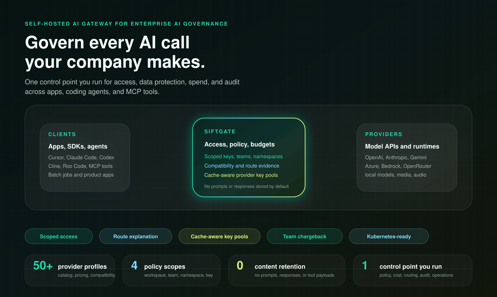

# SiftGate 문서

[문서 홈](../../README.md) · [프로젝트 README](../../../README.md)

현재 릴리스: **v2.12.16**.

**엔터프라이즈 AI 거버넌스를 위한 셀프 호스팅 AI 게이트웨이.** SiftGate는 업무 애플리케이션, 코딩 에이전트, MCP 도구에서 발생하는 모든 AI 호출 앞에 직접 운영하는 단일 통제 지점을 둡니다. 공급자 키는 자체 서버에 머물고, 접근은 정책을 따르며, 지출은 예산으로 관리되고 팀별로 배분됩니다. 모든 요청에 감사 기록이 남지만 프롬프트와 응답은 기본적으로 저장하지 않습니다.

<p align="center">
  
</p>

## 기업이 SiftGate를 쓰는 이유

| AI 사용이 늘면서 생기는 문제 | SiftGate가 바꾸는 점 |
| --- | --- |
| 섀도 AI와 키 난립 | 공급자 키는 게이트웨이 안에만 두고, 팀에는 범위가 제한되고 회수 가능한 Gateway API Key를 발급합니다. |
| 보안 검토에서 도입이 멈춤 | 기본은 메타데이터만 저장합니다. 프롬프트, 응답, 소스 코드, 도구 페이로드, 시크릿을 저장하지 않습니다. |
| 내역 없는 총액 청구서 | 글로벌, 네임스페이스, 팀, 키 단위 예산, 비용 배분 내보내기, 캐시 인식 키 풀. |
| 공급자 한 곳의 장애로 모두 멈춤 | 폴백 체인, 서킷 브레이커, 자격 증명 장애 조치, 요청별 라우팅 설명. |

## 네 가지 거버넌스 축

| 축 | 다루는 범위 |
| --- | --- |
| 액세스 및 정책 | 범위 제한 키, Workspace, Team, Policy Namespace(교집합이 비면 거부), 키별 모델 풀, Agent Profile, MCP Tool Gateway, RBAC와 OIDC. |
| 데이터 보호 및 감사 | 메타데이터만 남기는 로그와 라우팅 기록, PII·시크릿·프롬프트 인젝션용 로컬 가드레일, 해시 체인 관리 감사, 버전 관리되는 설정 롤백. |
| 비용 관리 | 일일 토큰·비용 예산, Workspace 가격표, 비용 보고서, CSV/JSON 비용 배분, 이상 징후 증거, 캐시 절감액. |
| 안정성 및 운영 | 스마트 라우팅, 폴백, 서킷 브레이커, 라우팅 설명, PostgreSQL/Redis/Kubernetes 운영 경로, Sigstore 서명 릴리스 키트, 검토된 업그레이드 계획. |

## 평가 순서

1. 도입 판단: [Enterprise overview](../../enterprise-overview.md)
2. 보안 검토: [Security and compliance brief](../../security-compliance-brief.md)
3. 30분 데모: [PoC playbook](../../poc-playbook.md)

## 빠른 시작

```bash
git clone https://github.com/seanbabalala/SiftGate.git
cd SiftGate
# .nvmrc에 맞춰 Node >=22.13.0 <23을 선택합니다.
npm run runtime:check
npm install
cd frontend && npm install && cd ..
cp gateway.config.example.yaml gateway.config.yaml
cp .env.example .env
npm run build
# 시작하기 전에 비공개 YAML에서 dashboard.password(또는 OIDC)를 설정합니다.
npm start
```

`http://localhost:2099/dashboard`를 열고 Provider Node를 하나 추가한 뒤 Gateway API Key를 만들고 `http://localhost:2099/v1/chat/completions`로 요청을 보냅니다. 버전이 고정되고 일회용 활성화 코드를 쓰는 Docker 설치는 [customer install kit](../../customer-install.md)를 사용하세요.

## 공급자 자격 증명 풀

하나의 Provider Node에 여러 상위 키를 둘 수 있습니다. `cache_aware`는 공급자 프롬프트 캐시를 만들거나 읽은 요청을 같은 키에 유지하고, 429, 5xx, 시간 초과가 발생하면 다른 키로 전환합니다.

```yaml
credential_pool:
  enabled: true
  strategy: cache_aware
  sticky_by: agent_session
  cooldown_ms: 60000
  retry_on_status: [429, 500, 502, 503, 504]
```

## 문서 지도

| 목적 | 시작 문서 |
| --- | --- |
| 엔터프라이즈 평가 | [Enterprise overview](../../enterprise-overview.md), [Security and compliance brief](../../security-compliance-brief.md), [PoC playbook](../../poc-playbook.md), [Comparison](../../COMPARISON.md) |
| 로컬 체험과 대시보드 | [Quickstart](../../QUICKSTART.md), [Dashboard](../../DASHBOARD.md), [OSS Concepts](../../OSS_CONCEPTS.md), [Playground](../../PLAYGROUND.md) |
| 운영 환경 | [Customer install](../../customer-install.md), [Production](../../PRODUCTION.md), [Kubernetes and Helm](../../KUBERNETES.md), [State Backends](../../STATE_BACKEND.md), [Secret Management](../../SECRET_MANAGEMENT.md), [Config Audit and Rollback](../../CONFIG_AUDIT_ROLLBACK.md) |
| 에이전트와 MCP 도구 | [Coding Agent Gateway](../../CODING_AGENT_GATEWAY.md), [Agent Integrations](../../AGENT_INTEGRATIONS.md), [MCP Tool Gateway](../../MCP_GATEWAY.md), [Agent + MCP Demo](../../AGENT_MCP_DEMO.md) |
| 비용 거버넌스 | [Cost Platform](../../COST_CHARGEBACK_PLATFORM.md), [Billing Loop](../../BILLING_LOOP.md), [Policy Namespaces](../../NAMESPACES_AND_SHADOW.md) |
| 공급자와 라우팅 | [Provider Catalog](../../PROVIDER_CATALOG.md), [Provider Compatibility](../../PROVIDER_COMPATIBILITY.md), [Routing Recommendations](../../ROUTING_RECOMMENDATIONS.md), [Multimodal Capabilities](../../MULTIMODAL_CAPABILITIES.md) |
| 관측성과 알림 | [Operator Observability](../../OPERATOR_OBSERVABILITY.md), [Webhook Alerts](../../WEBHOOK_ALERTS.md), [Log Sinks](../../LOG_SINKS.md), [Security](../../SECURITY.md) |
| 개발 | [Architecture](../../ARCHITECTURE.md), [API Reference](../../API_REFERENCE.md), [SDKs](../../SDKS.md), [Plugins](../../PLUGINS.md), [Release Checklist](../../RELEASE_CHECKLIST.md) |
